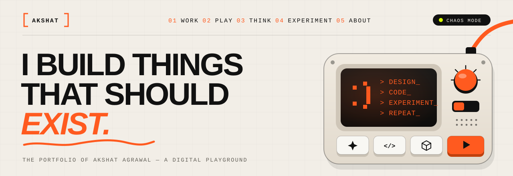
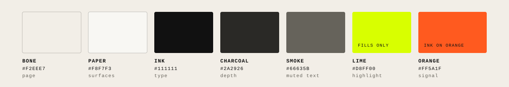

<p align="center">
  
</p>

<p align="center">
  <b>AKSHAT/OS</b> · the portfolio of Akshat Agrawal, built as a digital playground<br />
  <sub>Next.js 16 · React 19 · GSAP · Three.js · View Transitions · Mobile-first</sub>
</p>

---

## The idea

Most portfolios are brochures. This one is a machine you operate.

It boots like an old computer, navigates like a control console, and every project opens into **its
own world**: a train journey, an AI command centre, a denim lookbook. Each world is fitted around a
working version of the product. A switch on the console turns on **Chaos Mode**, and the whole site
becomes a stranger version of itself.

**Controlled chaos:** roughly 70% strict system, 20% play and 10% surprise. The calm sections are what
make the wild moments land.

```
BOOT → ENTER → PLAY → SELECTED WORLDS → THINK → IDENTITY → LAB → CONTACT → SESSION COMPLETE → RESTART ↻
```

## What's inside

| | |
|---|---|
| **Boot sequence** | A short CRT cold start on the first visit. Skippable, and replayed by *Restart experience*. |
| **Control-console nav** | Indexed links, a sliding active marker, and toggles for Chaos, Sound and Lights. It folds into a full-screen control panel on phones. |
| **The console** | A code-generated 3D device in the hero. Its keys change the CRT screen, the switch flips Chaos Mode, and the knob drives a tiny hidden game. |
| **Chaos Mode** | A real alternate state: letters that dodge the cursor, drifting UI fragments, a warped grid, glitch transitions. Navigation stays usable throughout. |
| **Page transitions** | Built on the native View Transitions API. An iris opens from the click point, a portal morphs into its world, a world switches off like a CRT, and the rail wipes between worlds. |
| **Work index** | One set of projects in five layouts (Grid, List, Chaos, Timeline, System) that rearrange with FLIP animation. |
| **Project worlds** | Every project gets its own environment, with its own palette, motion language and working product preview. |
| **Playground · Think · Experiments · About** | A physics workbench, a switchboard of design principles, six runnable creative-coding experiments, and an identity you explore rather than read. |
| **Found UI** | Live cursor coordinates, scroll velocity, local time, build stamps. Subtle, never in the way. |
| **Sound** | Interface sounds synthesised with WebAudio. No audio files, and off until you turn it on. |
| **Hidden things** | Keyboard shortcuts (press `?`), a secret blueprint mode, and at least one classic cheat code. |

## Project worlds

Each project picks a world in its data file. A world is one reusable environment that renders the
project's story, process, decisions, stack and results inside its own metaphor, with the product
itself running at the centre.

| # | Project | World | The product inside it |
|---|---|---|---|
| 01 | DecisionOS | AI command centre | Ask the board: four AI agents argue a decision, then a brief assembles |
| 02 | Safar Zaika | Indian railway journey | Order regional food by PNR, then track it along the route |
| 03 | Fybr8 | Denim lookbook | A working store with fabric-first product pages and a fit finder |
| 04 | CredWise | Analyst ledger terminal | Score a borrower and see the reasons behind the number |
| 05 | Synthora SID | Campus blueprint | The student app: next class, attendance margin, digital ID |
| 06 | Null Field | Shader instrument | A live WebGL instrument with knobs, presets and a record key |

> The six projects are realistic **demo content** while the real case studies are prepared. Content
> lives in `/data`, so swapping it in needs no UI changes.

**Real websites inside worlds.** A project's real site can run *inside* its world's screen (the train
window, the command-centre display), sandboxed and loaded only on demand. This is done only with the
site owner's consent, and never by bypassing a site's framing rules. See
[`docs/LIVE-SITES.md`](docs/LIVE-SITES.md).

## Design system

<p align="center"></p>

**Typography**

| Role | Typeface | Notes |
|---|---|---|
| Display + UI | **Archivo** | Variable weight (100–900) *and* width (62–125). Headlines stretch with cursor speed. |
| Editorial accent | **Instrument Serif** | One word, one name, one quote at a time. Never body copy. |
| Technical voice | **IBM Plex Mono** | System messages, coordinates, indexes. |
| CRT phosphor | **VT323** | Only inside device screens and the boot sequence. |

**Motion:** durations of 120 / 240 / 640 / 900 / 1100 ms, and three eases: *expo-out* for arrivals,
a mechanical *machine* curve for state changes, and an overshooting *snap* for keys and switches.
Animations stick to transform, opacity and clip-path. Reduced-motion preferences are always
respected.

**Interaction language:** every button is a physical key. It's pulled magnetically toward the cursor,
fills on hover and travels 2 px when pressed. Links grow the next page out of the click point. The
cursor changes its shape and wording to suit what it's over: *open*, *view*, *drag*.

**Rules this site doesn't break**
- No eyebrow → heading → subline → two-buttons formula, and no section numbers stamped on every
  heading.
- Cards aren't the default building block. Corners are a deliberate mix of sharp, 4, 8, 12 px and pill.
- No filler copy and no dead buttons. If something looks interactive, it is.

The full system lives in [`docs/BRIEF.md`](docs/BRIEF.md), with tokens in
[`app/globals.css`](app/globals.css).

## Mobile-first and accessible

Designed for phones from the first line of code, not squeezed down later:
- Every view is checked at 360, 390 and 430 px wide, in landscape, and on tablets.
- Touch targets are at least 44 px.
- Nothing is hover-only.
- Scrolling stays native on touch; there's no scroll-jacking.
- Fixed bars respect notches and the home indicator.
- Effects get a lighter budget on touch devices.

Pinch-zoom stays on, every control works from the keyboard with a visible focus ring, text meets AA
contrast, and reduced motion is honoured.

## Built with

| | Why |
|---|---|
| **Next.js 16** (App Router, Turbopack) + **React 19.3** | Static pages, plus native `<ViewTransition>` for page morphs |
| **Tailwind CSS v4** | Design tokens as CSS variables, with custom `chaos:` `fine:` `coarse:` variants |
| **GSAP 3** (ScrollTrigger, SplitText, Flip, Draggable, ScrambleText) | Timelines, scroll scenes, kinetic type |
| **Motion** | Presence and layout animation for components |
| **Lenis** | Smooth scrolling on desktop, kept in sync with ScrollTrigger |
| **three.js** + **React Three Fiber** + **drei** | The console and the world scenes. Models are generated in code as GLB files. |
| **matter-js** | Physics for the playground |
| **Swiper** | Touch-first carousels on phones |
| **lucide-react** | Line icons |

## Run it locally

```bash
npm install
npm run dev        # http://localhost:3000
```

| Script | What it does |
|---|---|
| `npm run build` / `npm start` | Production build / serve |
| `npm run check -- <paths>` | Type-check + lint (scoped to the given paths) |
| `npm run models` | Regenerate every 3D model from `scripts/models/*.mjs` into `public/models/` |
| `npm run shot -- <route> <out.png> [--mobile]` | Screenshot a route of a running server |
| `npm run embeds -- <url>` | Check whether a site allows being shown inside the portfolio |
| `npm run capture -- <url> <slug>` | Full-page captures for sites that can't be embedded |

## Structure

```
app/                    routes: / · /work · /work/[slug] · /playground · /think · /experiments · /about
components/
  system/               boot, console nav, HUD, cursor, grain, scroll rail, shortcuts, secret mode
  chaos/                Chaos Mode
  hero/  home/          the home journey, scene by scene
  work/                 the work index and its five modes
  worlds/               one folder per world + the shell around them + LiveScreen
  playground/ think/ experiments/ about/
  ui/                   keys, links, reveals, marks
  transitions/          page transitions and shared-element morphs
lib/                    system state, sound, GSAP setup, pointer, hooks, motion tokens, types
data/                   every word and number on the site
scripts/                3D model generators, checks, screenshots, embed tools
docs/                   design brief, live-site guide, README assets
```

## Adding a real project

1. Add a file to `data/projects/` (copy a demo one) and register it in `data/projects/index.ts`.
2. Choose its `environment` (world), its colours and its `scene` content.
3. Optionally add `live: { url, mode, permission }` so the real site runs inside the world. Check the
   link first with `npm run embeds`.

---

<p align="center"><sub>Design &amp; development by <b>Akshat Agrawal</b> · © 2026 · All rights reserved.</sub></p>
